# 🚀 Awesome Sales Engagement &amp; CRM Platform Ecosystem 📈

  <strong>A high-performance, curated index of unified sales engagement tools, revenue intelligence software, and modern open-source CRM architectures.</strong>

  
  
  
  
  
  
  

  <em>SEO Keywords: CRM, Sales Engagement Platform, Sales Cadences, Cold Email Outreach, Pipeline Management, B2B Prospecting, RevOps, Self-Hosted CRM, Open Source CRM, AI SDR, Lead Enrichment, Deal Tracking.</em>

---

## 🎯 Sector Overview &amp; Market Dynamics 🌐

The global Customer Relationship Management (**CRM**) software sector is projected to reach **$85B–$88B** in 2026 (expanding at an ~8–11% CAGR), while the dedicated **Sales Engagement Platform (SEP)** market accelerates past **$9.2B–$9.6B** (~14–16% CAGR). 

- 🏛️ **CRM Core (Consolidated Oligopoly):** The enterprise foundation remains heavily consolidated among mega-cap market leaders (*Salesforce, Microsoft Dynamics 365, HubSpot, and Zoho*), who continue absorbing adjacent sales productivity capabilities via agentic AI layers.
- ⚡ **Sales Engagement &amp; Outreach (Moderate-to-High Fragmentation &amp; Convergence):** Outbound cadences, cold email sequencing, multi-channel dialers, and autonomous AI SDR agents emerged from high fragmentation. Today, the space is experiencing rapid platform convergence as standalone engagement suites (*Outreach, Salesloft, Clari*) transition into holistic revenue execution platforms, while open-source projects (*Twenty, AgentSDR, Horilla*) bridge self-hosted data autonomy with AI-powered sales cadences.

---

## 📑 Table of Contents 📌

- [🎯 Sector Overview &amp; Market Dynamics 🌐](#-sector-overview--market-dynamics-)
- [🏢 SaaS &amp; Commercial Hosted Platforms 💼](#-saas--commercial-hosted-platforms-)
- [🔓 Open-Source GitHub Projects 🛠️](#-open-source-github-projects-️)
  - [⭐ Featured Project Breakdown 🔍](#-featured-project-breakdown-)
- [🤝 How to Contribute 💡](#-how-to-contribute-)
- [💖 Support &amp; Sponsorship ☕](#-support--sponsorship-)
- [⭐ Star History 📊](#-star-history-)
- [⚠️ Disclaimer 🛡️](#️-disclaimer-️)

---

## 🏢 SaaS &amp; Commercial Hosted Platforms 💼

The table below lists leading commercial CRM and sales engagement suites, sorted in descending order by **Company Scale (Market Capitalization, Valuation, and Revenue)**.

| Platform | 🏢 Scale (Revenue / Valuation) | 💵 Pricing (Starting Tier) | 🎁 Free Tier Limits / Free Trial | 📝 Core Capabilities |
| :--- | :--- | :--- | :--- | :--- |
| **[Salesforce Sales Cloud](https://www.salesforce.com/)** | ~$200B+ Market Cap / $41.5B Revenue (FY2026) | $25/user/month (Starter Suite, monthly or annual) | 30-day free trial (includes full access to standard CRM features and Starter Suite for up to 2 users) | Enterprise standard CRM with customizable deal pipelines, forecasting, Agentforce AI, and AppExchange ecosystem. |
| **[HubSpot Sales Hub](https://www.hubspot.com/)** | ~$11B–$12B Market Cap / $3.13B+ Revenue | $20/seat/month ($15/seat/month billed annually for Starter) | Free forever plan: unlimited users, up to 1,000,000 contacts, deal pipelines, email tracking, and quote generation | Inbound-driven smart CRM and sales engagement platform with sequences, deal pipelines, and automated prospecting. |
| **[Zoho CRM](https://www.zoho.com/crm/)** | ~$5B–$12B Est. Valuation / ~$1.5B Revenue | $14/user/month (Standard plan billed annually, or $20/month billed monthly) | Free forever plan: up to 3 users, 5,000 records limit, basic lead and contact management, workflow rules | Comprehensive, cost-effective CRM ecosystem with pipeline tracking, multi-channel communication, and Zia AI sales assistant. |
| **[Outreach](https://www.outreach.io/)** | $4.4B Valuation (Series G) / ~$250M–$300M ARR | ~$100/user/month (Billed annually; custom implementation fees apply) | 14-day guided trial upon sales consultation (no perpetual free tier; full workflow and sequence testing) | Enterprise sales engagement standard featuring AI sequences, conversation intelligence, and revenue execution workflows. |
| **[Freshsales](https://www.freshworks.com/freshsales/)** | ~$3.6B–$4.0B Market Cap / ~$750M+ Revenue | $9/user/month (Growth plan billed annually, or $11/month billed monthly) | Free forever plan: up to 3 users, contact management, deal stages, built-in chat, and phone dialer | Lightweight CRM by Freshworks offering visual sales pipelines, AI deal insights (Freddy AI), and built-in calling. |
| **[Clari Groove](https://www.groovehq.com/)** | $2.6B Valuation (Parent: Clari) / ~$170M+ Combined ARR | ~$50/user/month (Core package billed annually; enterprise bundles available) | 14-day pilot trial via enterprise demo (no perpetual free tier; Salesforce integration sandbox included) | Salesforce-native sales engagement platform offering automated activity capture, multi-channel sequences, and sync. |
| **[Salesloft](https://salesloft.com/)** | $2.3B Valuation (Vista Equity) / ~$150M+ ARR | ~$75/user/month (Essential tier billed annually; minimum seat commitments apply) | 14-day guided enterprise trial upon demo request (no perpetual free tier; access to cadences and dialer) | Enterprise sales engagement engine combining multi-channel cadences, conversation intelligence, and forecasting. |
| **[Apollo.io](https://www.apollo.io/)** | $1.6B Valuation (Series D) / ~$134M ARR | $49/user/month (Basic plan billed annually, or $65/month billed monthly) | Free forever plan: 1 user, 10,000 email credits/month, 5 mobile credits/month, basic filters, and 2 active sequence limits | All-in-one B2B lead database and outreach suite featuring 275M+ contacts, email warmup, and automated cadences. |
| **[Pipedrive](https://www.pipedrive.com/)** | ~$1.5B Acquisition Valuation (Vista Equity) | $14/user/month (Lite plan billed annually, or $24/month billed monthly) | 14-day free trial (no credit card required; access to full pipeline management, custom fields, and mobile apps) | Sales-focused visual pipeline CRM known for simplicity, activity-based selling methodologies, and deal rotting alerts. |
| **[Close](https://close.com/)** | Bootstrapped / ~$45M–$50M ARR | $49/user/month (Startup tier billed annually, or $59/month billed monthly; Solo available at $29/mo) | 14-day free trial (full access to email sequences, built-in VoIP calling, pipeline stages, and SMS tools) | High-velocity conversation-first CRM built for SMB sales teams with native calling, SMS, two-way email sync, and cadences. |

---

## 🔓 Open-Source GitHub Projects 🛠️

The table below lists top open-source CRM platforms, sales engagement automation suites, and outbound outreach tools, ranked in descending order by **GitHub Stars_Count**.

| Repository | ⭐ GitHub_Stars | 🎯 Primary Focus &amp; Architecture | 📜 License |
| :--- | :--- | :--- | :--- |
| **[Twenty](https://github.com/twentyhq/twenty)** |  | Modern Salesforce CRM alternative; custom objects, Kanban pipelines, and MCP support for AI agents | AGPLv3 |
| **[Odoo](https://github.com/odoo/odoo)** |  | Comprehensive modular ERP/CRM suite; opportunity tracking, automated lead routing, and quotation engine | LGPLv3 |
| **[ERPNext](https://github.com/frappe/erpnext)** |  | Enterprise ERP and CRM; complete pipeline tracking, customer portal, sales orders, and communication history | GPLv3 |
| **[Chatwoot](https://github.com/chatwoot/chatwoot)** |  | Omni-channel customer engagement platform; live chat, WhatsApp, email, and social messaging inbox | AGPLv3 |
| **[Monica](https://github.com/monicahq/monica)** |  | Personal & business relationship management (PRM/CRM); contact logs, interactions, and follow-up reminders | AGPLv3 |
| **[Krayin CRM](https://github.com/krayin/laravel-crm)** |  | Laravel-based sales CRM; visual Kanban lead pipelines, contact management, activity scheduling, and webhooks | MIT |
| **[Comp AI CRM](https://github.com/trycompai/crm)** |  | Agentic-first open-source CRM architected specifically for AI agents, automated enrichment, and workflows | Apache-2.0 |
| **[Mautic](https://github.com/mautic/mautic)** |  | Marketing automation and multi-channel campaign sequencer; automated lead scoring and email drip flows | GPLv3 |
| **[SuiteCRM](https://github.com/SuiteCRM/SuiteCRM)** |  | Enterprise-grade SugarCRM open-source successor; sales pipeline, contract management, and workflow automation | AGPLv3 |
| **[Frappe CRM](https://github.com/frappe/crm)** |  | Modern Frappe-powered CRM; visual deal pipelines, email sync, omni-channel communication, and REST APIs | AGPLv3 |
| **[Harvey](https://github.com/ethanplusai/harvey)** |  | Autonomous AI sales agent; prospects, writes personalized cold emails, triggers outbound sequences, and handles replies | MIT |
| **[EspoCRM](https://github.com/espocrm/espocrm)** |  | Lightweight and customizable responsive CRM; sales automation, lead conversion, calendar, and REST API | AGPLv3 |
| **[Horilla CRM](https://github.com/horilla/horilla-crm)** |  | Django CRM with native sales cadences (scheduled multi-step outreach), opportunities, and HTMX UI | LGPLv3 |
| **[AgentSDR](https://github.com/kandid-ai/agentsdr)** |  | Multi-channel self-hosted AI SDR; email, LinkedIn, and WhatsApp sequences with AI reply triage and CRM | MIT |

---

### ⭐ Featured Project Breakdown 🔍

- **[Twenty](https://github.com/twentyhq/twenty)**   
  The leading modern AGPLv3 open-source CRM platform engineered as a modular Salesforce alternative. Features full relational objects, Kanban stages, visual workflow automations, and native Model Context Protocol (MCP) support for external AI agent integration.
- **[Odoo](https://github.com/odoo/odoo)**   
  High-powered suite with an extensive CRM ecosystem providing automated lead scoring, email routing, quotation generation, and comprehensive revenue analytics.
- **[ERPNext](https://github.com/frappe/erpnext)**   
  Full-featured open-source business and CRM platform built with Python & JavaScript on Frappe framework, supporting end-to-end opportunity lifecycle and customer communication histories.
- **[Chatwoot](https://github.com/chatwoot/chatwoot)**   
  Open-source multi-channel customer communication hub connecting Email, Live Chat, WhatsApp, Twitter, and Facebook into a synchronized inbox.
- **[Comp AI CRM](https://github.com/trycompai/crm)**   
  Next-gen agentic CRM built specifically for AI agents with programmatic APIs, automated contact enrichment, and trigger-driven sales workflows.
- **[Mautic](https://github.com/mautic/mautic)**   
  Production-grade marketing automation and outbound sequencer for complex lead nurturing, email drip campaigns, and dynamic segmentations.
- **[Harvey](https://github.com/ethanplusai/harvey)**   
  Autonomous AI outbound agent that discovers prospective leads, crafts contextual personalized outreach, executes email cadences, and triages inbound responses.
- **[Horilla CRM](https://github.com/horilla/horilla-crm)**   
  Django and HTMX powered CRM featuring built-in multi-channel sales cadences (calls, emails, tasks) alongside deal pipeline tracking.
- **[AgentSDR](https://github.com/kandid-ai/agentsdr)**   
  Dockerized multi-channel outbound AI workspace combining email warmup, LinkedIn outreach, WhatsApp engagement, and a human-in-the-loop reply review CRM.

---

## 🤝 How to Contribute 💡

Contributions from revenue operations practitioners, sales tech engineers, and open-source developers are welcome!

1. 🍴 **Fork the repository**.
2. 🌿 **Create a new branch**: `git checkout -b feature/add-new-tool`.
3. 📝 **Add or update entries**: Ensure SaaS additions include company scale, starting tier prices, and explicit free tier/trial limits. Ensure open-source additions include the official GitHub Stars_Badge format (`style=social&color=white`) linking to `/stargazers`.
4. 🚀 **Commit your changes**: `git commit -m 'Add ToolName to Sales Engagement ecosystem'`.
5. 📤 **Push and submit a Pull Request** with a concise description of why the tool is valuable.

---

## 💖 Support &amp; Sponsorship ☕

If you found this curated ecosystem list helpful in designing your sales stack, benchmarking tools, or discovering open-source alternatives, consider showing your support:

- ⭐ **Star this repository** to help others discover it across GitHub.
- 🍴 **Fork and share** with your revenue operations (RevOps), sales leadership, and growth engineering teams.
- ☕ **Buy me a coffee / Sponsor the project**: Contributions help maintain up-to-date benchmarks, research emerging open-source tools, and expand ecosystem directories.

👉 **[Sponsor on GitHub Sponsors / Buy a Coffee](https://github.com/sponsors/ishandutta2007)**

Thank you for supporting open-source software and transparent sales technology! ❤️

---

## 📊 Star History 📈

---

## ⚠️ Disclaimer 🛡️

- This is a **community-curated index** published for informational, educational, and architectural evaluation purposes.
- Sales engagement and CRM platforms handling prospect and customer data must strictly adhere to data privacy standards (GDPR, CAN-SPAM, CASL, CCPA). Bulk email warmup, unsolicited WhatsApp outreach, and LinkedIn scraping carry platform suspension and legal risks that self-hosted implementations do not negate.
- Verify software licenses before commercial deployment (AGPLv3, LGPLv3, Apache-2.0, MIT, etc.).

---

  Curated with ❤️ for sales engineers, SDRs, RevOps specialists, and B2B founders worldwide.

